<p align="center">
  <h1 align="center">⚡ QC2015P 充电通信协议 本地测试平台</h1>
  <p align="center"><b>GB/T 27930.2-2024 标准 · 向下兼容 GB/T 27930-2015 · 充电桩与车辆双端仿真 · 一键启动即用</b></p>
  <p align="center">
    
    
    
    
    
    
  </p>
</p>

<p align="center">
  <b>🇨🇳 中文</b> | <a href="README_EN.md">🇬🇧 English</a>
</p>

---

## 🎬 演示视频

<p align="center">
  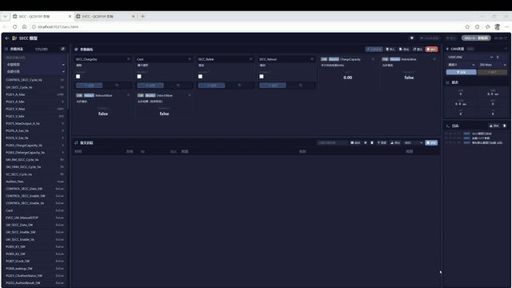
</p>

<details>
<summary>📥 原始高清视频下载（1080p MP4）</summary>

从 [Releases](https://github.com/Miki-Hunter/QC2015P_Platform/releases) 页面下载原始录制文件。

</details>

---

## 📖 这是什么？

一句话：**一台电脑 + 一个 CAN 盒子（USB 转 CAN 的小转接器），就能在实验室里完整模拟充电桩与电动汽车的充电通信全过程。**

```
┌──────────────────────────────────────────────────────────┐
│                    你的电脑（Windows）                      │
│                                                          │
│   ┌─────────────────────────────────────────────────┐    │
│   │            QC2015P 测试平台 (exe)                │    │
│   │                                                 │    │
│   │   ┌───────────┐       ┌───────────┐            │    │
│   │   │  SECC 模型 │       │  EVCC 模型 │            │    │
│   │   │ (充电桩端)  │       │ (车辆端)   │            │    │
│   │   └─────┬─────┘       └─────┬─────┘            │    │
│   │         └──────────┬────────┘                   │    │
│   │              CAN 总线通信                        │    │
│   └────────────────────┼────────────────────────────┘    │
│                        │ USB                             │
│              ┌─────────┴─────────┐                       │
│              │   ZLG USBCAN2     │                       │
│              │   CAN 收发器       │                       │
│              └───────────────────┘                       │
└──────────────────────────────────────────────────────────┘
```

> 💡 **没有 CAN 盒子也能跑**：内置「虚拟 CAN」，充电桩和车辆两路在电脑内部直连互通。

**一句话价值：把充电通信测试从"必须真车真桩、靠人盯"变成"一台电脑、可反复重现、全过程留痕"。**

| 传统做法 | 用本平台 |
|---------|--------|
| 得凑齐真实充电桩 + 真实车辆，还要排队等台架 | 充电桩和车辆两端都由软件扮演，一台电脑全包 |
| 偶发故障想重现一次，要重新约车约桩 | 拔枪、超时、丢帧等异常场景，改个参数就能反复重现 |
| 改一个测试条件要重新编译、烧录、重启 | 网页上直接改，毫秒级生效，不用停机 |
| 出了故障只能靠人盯着屏幕回忆现场 | 自动留存 10 万条通信记录，可随时导出复盘 |
| 报文是一串十六进制数，人眼读不懂 | 自动翻译成"电压 / 电流 / SOC"等参数名和数值，不同报文不同颜色 |

> 如果你只想知道"这东西好在哪"——**省人、省设备、省时间，而且测试结果可重复**。

**典型用途**：研发自测 · 认证 / 验收预测试 · 客户演示 · 现场故障复现

---

## 🌟 核心亮点

<table>
<tr>
<td width="50%" valign="top">

### 🚗🔌 充电桩和车辆，一台电脑同时扮演
两端**同时运行**在电脑里，各自按 1 毫秒一步推进，通过 CAN 线实时对话，完整走完一次充电全过程。

</td>
<td width="50%" valign="top">

### 📊 打开浏览器就能看
不用装客户端：**改参数、看报文、盯充电进度**，当前进行到哪一步一目了然。

</td>
</tr>
<tr>
<td width="50%" valign="top">

### 🔧 参数即改即生效
把参数拖到画布上改个数值、点「应用」，**毫秒级生效**——不用重启，更不用重新烧录。

</td>
<td width="50%" valign="top">

### 🤖 不会写代码也能自动化
**拖拽积木**就能编排测试脚本，点一下自动跑完并给出 PASS/FAIL；会 Python 的同事也能导出脚本离线运行。

</td>
</tr>
<tr>
<td width="50%" valign="top">

### 🔄 新旧两版国标都支持
同一套模型内置 **2024 新国标**与 **2015 旧快充**两套协议栈，跑哪套由两端协商。

</td>
<td width="50%" valign="top">

### 📝 全过程可录制、可回放
通信记录可导出成 **ASC**（CANoe 直接打开）或 **BLF**，复盘、举证、专业工具分析都方便。

</td>
</tr>
</table>

---

## 🖥️ 界面一览

### 主页

<p align="center">
  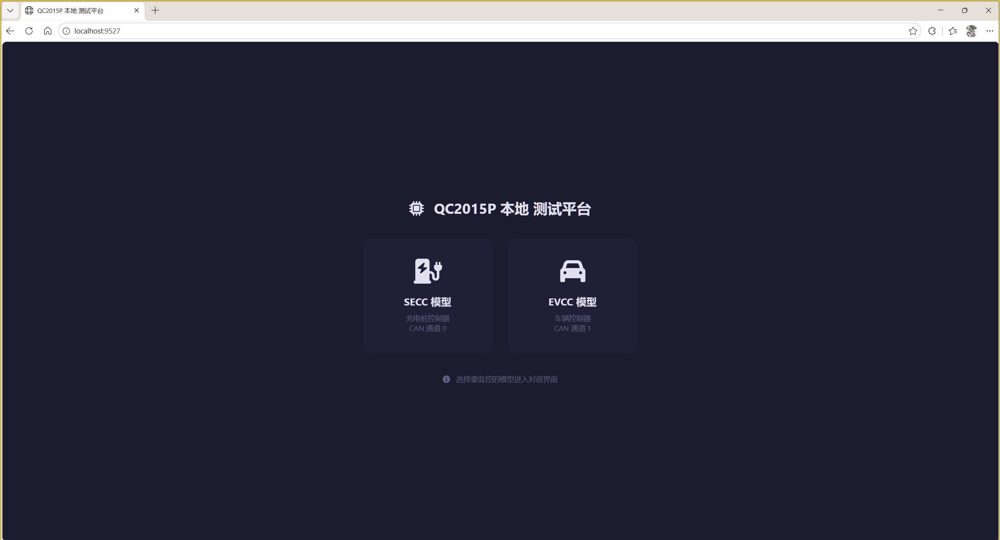
  <br/><em>▲ 主页 — 选择进入 SECC（充电桩端）、EVCC（车辆端）或自动化测试</em>
</p>

### SECC 页面（充电桩端）— 全貌

<p align="center">
  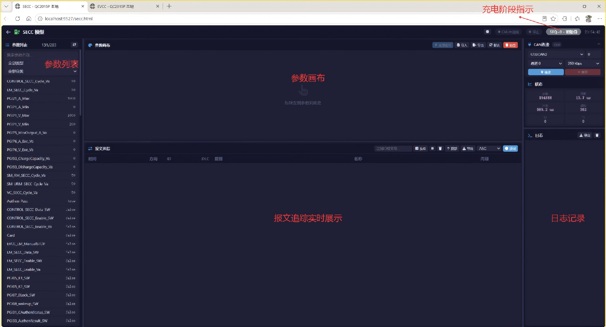
  <br/><em>▲ SECC 页面 — 顶部充电阶段指示 + 左侧参数列表 + 中间参数画布 + 底部报文追踪</em>
</p>

### EVCC 页面（车辆端）— 全貌

<p align="center">
  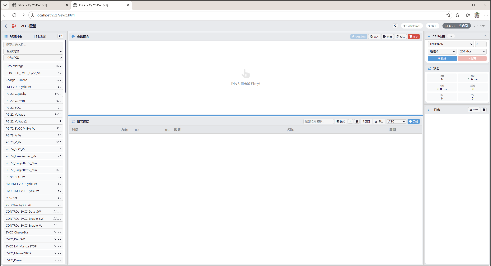
  <br/><em>▲ EVCC 页面 — 布局与 SECC 一致，参数和报文内容对应车辆端</em>
</p>

---

## 🔍 功能详解

### 1️⃣ 充电阶段实时指示

顶部导航栏实时显示当前充电阶段，颜色随阶段自动变化，**一眼识别充电进度**：

<p align="center">
  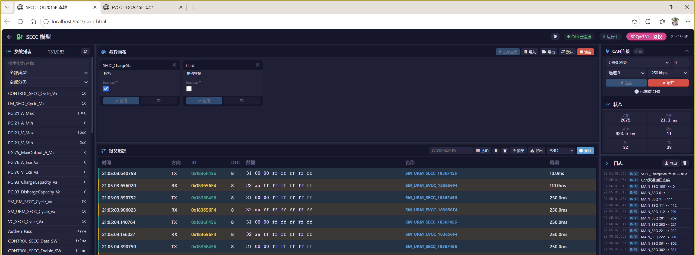
  <br/><em>▲ 顶部 SEQ 徽章 — 当前阶段「鉴权」，粉色背景</em>
</p>

| 阶段 | SEQ 值 | 颜色 |
|:-----|:------:|:----:|
| 初始值 | 0 | 🩶 灰色 |
| 版本协商 | 1 | 🩵 青色 |
| 功能协商 | 2~200 | 💙 蓝色 |
| 参数配置 | 201~300 | 💜 紫色 |
| **鉴权** | **301~400** | **💗 粉色** |
| 预约充电 | 401~500 | ❤️ 玫红 |
| 输出回路检测 | 501~600 | 🧡 橙色 |
| 供电模式 | 601~700 | 🟠 深橙 |
| 预充 | 701~750 | 💚 绿色 |
| 能量传输 | 751~777 | 🟢 亮绿 |
| 充电暂停 / 中止 | 778~800 | 💛 / ❤️ |
| 充电结束 | 801~900 | 🩵 青绿 |

> 2015 旧协议的阶段（SEQ 10~99，标签带「(旧)」后缀）与等待重连/重启（SEQ 1000~1020）同样会显示；不在范围内的值显示为「未知」。

### 2️⃣ 参数画布 — 拖拽编辑

从左侧参数列表拖拽参数到画布区域，即可**实时查看和修改**参数值：

<p align="center">
  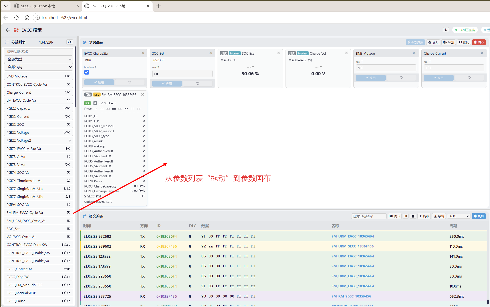
  <br/><em>▲ 参数画布 — 拖拽参数卡片到画布，实时编辑值，灰色小字为备注说明</em>
</p>

| 类型 | 可编辑 | 说明 |
|:-----|:------:|:-----|
| 🔧 模型参数 | ✅ 可读写 | **你想改的测试条件**（电压、电流、使能开关…），改完立即生效 |
| 📡 DBC 信号 | 👁️ 只读 | 报文里承载的信号值（如电压、电流），**自动翻译成参数名和数字** |
| 📊 Monitor 变量 | 👁️ 只读 | 模型内部的实时状态（充电进度、检测结果等） |

- 🖱️ **拖拽添加** · ✏️ **点击编辑** · 📋 **全部应用** · 💾 **导入/导出**（JSON） · 📌 **默认配置**（启动即显示常用参数）

### 3️⃣ 报文追踪 — 15 色标识

充电桩和车辆每秒要来回几百条消息（行话叫「报文」），这里把它们实时列出来，**每条消息自动分配一种颜色**，一眼就能看出谁在说话：

<p align="center">
  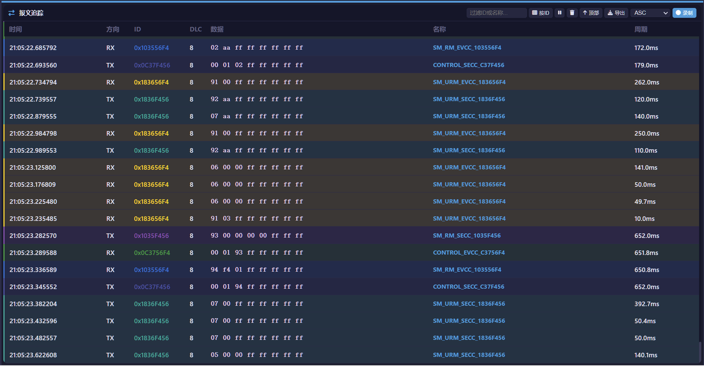
  <br/><em>▲ 报文追踪 — 15 种颜色按 ID 自动分配，左侧色条 + ID 文字色 + 微弱背景色三层标识</em>
</p>

- 📦 **10 万条留存** — 前后端各留 10 万条，虚拟滚动不卡顿
- 🔍 **实时过滤** — 按 ID 或名称筛选
- ⬆️ **上划回看** — 滚到顶部自动加载更早历史
- 🖱️ **点击解码** — 点击报文行查看 DBC 信号明细
- ⏱️ **报文周期** — 自动计算每条报文的发送周期

### 4️⃣ 录制与导出

<p align="center">
  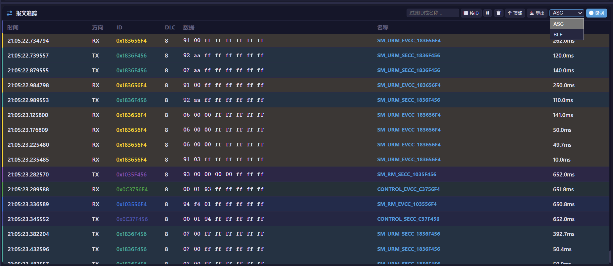
  <br/><em>▲ 录制控制 — 选择 ASC 或 BLF 格式，一键开始/停止录制</em>
</p>

| 格式 | 说明 | 打开工具 |
|:-----|:-----|:---------|
| **ASC** | 文本格式，人类可读 | CANoe / CANalyzer 直接打开 |
| **BLF** | Vector 二进制格式，文件更小 | CANoe / CANalyzer / Python |

- SECC 和 EVCC **独立录制**，互不干扰；文件自动命名（如 `SECC_20260830_143022.asc`）

### 5️⃣ 参数列表 — 三合一

<p align="center">
  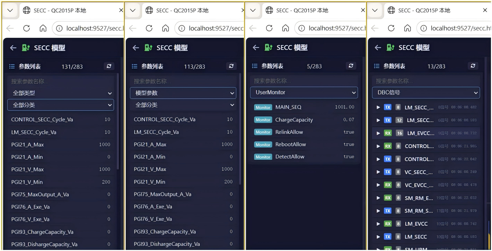
  <br/><em>▲ 参数列表 — 模型参数、DBC 信号、Monitor 变量三类统一展示</em>
</p>

- 🔧 **模型参数** — 按分类筛选、支持搜索、可编辑
- 📡 **DBC 信号** — 按报文分组，显示 TX/RX 方向与发送方
- 📊 **Monitor 变量** — 实时刷新，只读

### 6️⃣ 深色 / 浅色主题

<p align="center">
  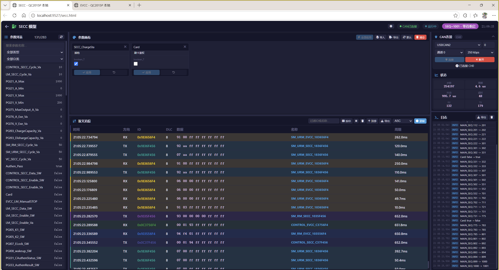
  &nbsp;&nbsp;
  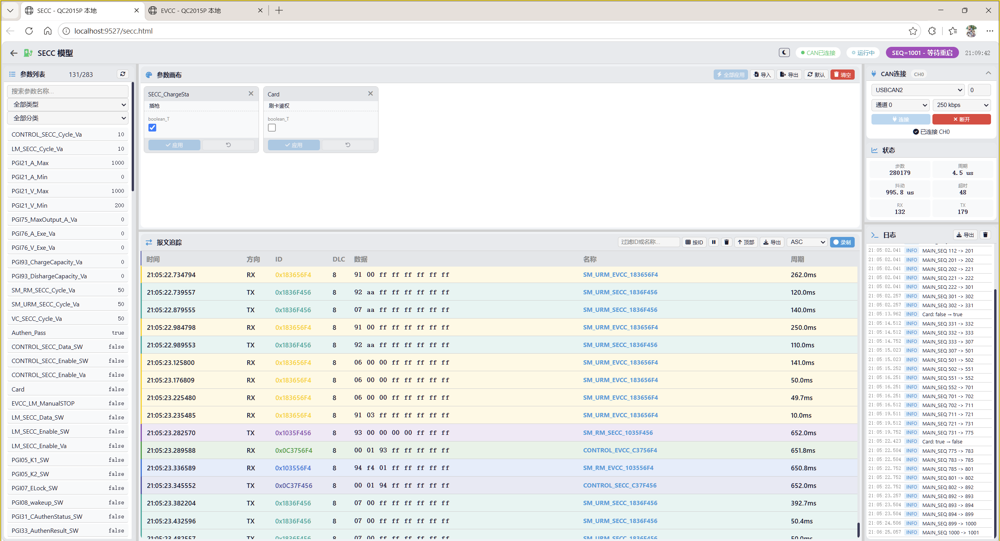
  <br/><em>▲ 左：深色主题（科技感，适合演示） | 右：浅色主题（清爽，适合日常）</em>
</p>

---

## 🔌 双协议：2024 新国标 + 2015 旧快充

同一套模型内置两套协议栈，**实际走哪套由两端协商**——「新桩配老车」「老桩配新车」不用换设备、不用换程序。

| 侧 | 开关 | 默认值 | 含义 |
|:---|:-----|:------:|:-----|
| 充电桩端 SECC | `SECC_2015P_Enable` | `true` | 本端**是否支持 2015P**（即 2024 新协议） |
| 车辆端 EVCC | `EVCC_2015P_Enable` | `true` | 同上 |

- **`true`（默认）**：支持 2024，同时兼容 2015。实际由协商决定——即使两端都勾选，也可能因**版本号低于 2.0.0** 回退到 2015 流程；只要有一方置 `false`，要么整体走 2015，要么充电失败。
- **`false`**：本端只跑 2015（2015P 向下兼容 2015，照常能充电）。

**支持的 2015 报文**

| 端 | 报文集 |
|:---|:-------|
| 🔌 SECC | `CHM` 握手 · `CRM` 辨识 · `CRO` 就绪 · `CML` 参数 · `CCS` 充电中 · `CST` 中止 · `CSD` 结束 · `CEM` 错误 |
| 🚗 EVCC | `BHM` 握手 · `BRM` 辨识 · `BCP` 参数 · `BRO` 就绪 · `BCL` 需求 · `BCS` 状态 · `BSM` 监控 · `BST` 中止 · `BSD` 结束 · `BEM` 错误 |

> 传输层报文以 `TP_*` 前缀管理。

**能控制到什么程度**（完整参数说明见 [docs/API.md](docs/API.md)）：

- **报文级**：单独决定每条报文发不发、多久发一次、内容用不用自定义值
- **信号级**：精确到报文里的某一个字段（比如电池类型、SOC）单独改写
- **自定义注入**：还能凭空注入一条报文，模拟异常设备
- **参数怎么命名**：都以 `_SW`（开关，默认关）+ `_Va`（开关打开后才生效的值）成对出现——不动任何参数时，全部由模型自动控制；具体参数名见 [docs/API.md](docs/API.md)

**界面里也能直接看懂 2015 报文**：内置 25 条报文词典（2024 的 10 条 + 2015 的 25 条），`BRM`/`BCP`/`BCS` 多包长报文经 J1939 传输协议自动重组后解码，追踪面板直接显示报文名和信号值。

📊 仓库根目录附带真实样本 [`向下兼容2015协议_V1.0.blf`](向下兼容2015协议_V1.0.blf)，用 CANoe / CANalyzer 直接打开即可复盘。

---

## 🧪 通信协议一致性测试（GB/T 34658-2025）

**对你的价值**：新国标落地后，"能充上电"已经不够——认证机构、主机厂验收看的是"**标准里要求的每一项，你是不是都符合**"。本目录收录用本平台跑一致性测试得到的**实测报文**，可直接作为测试证据留存、交付与复盘。

**GB/T 34658-2025《电动汽车非车载传导式充电机与电池管理系统之间的通信协议一致性测试》** 是 GB/T 27930 系列的**配套测试标准**，规定了"怎么一项一项地验"。

| 层 | 测什么 | 典型测试项 |
|:---|:-------|:-----------|
| **物理层 PL** | 硬件电气特性 | CAN 终端电阻（120 Ω±10%）、通信波特率（250 kbit/s） |
| **数据链路层 DL** | 单帧报文合不合规 | 数据帧格式、**版本协商** |
| **传输层 TL** | 多帧长消息传得对不对 | 长消息发送 / 接收（LM / RM / URM） |
| **应用层 AL** | 充电全流程业务逻辑 | 唤醒、功能协商、参数配置、鉴权、充电计划、供电模式、预充及能量传输、阶段确认、暂停、结束充电、向后兼容… |

标准全量用例约 **370 项**，充电桩端与车辆端各占一半，每项又分**正向**（正常流程）与**反向**（注入异常）：

| 被测端 | 正向 | 反向 | 合计 |
|:-------|:----:|:----:|:----:|
| 🔌 SECC（充电桩） | 71 | 114 | **185** |
| 🚗 EVCC（车辆） | 67 | 117 | **184** |

### 仓库里已收录的实测报文

📂 [`通信协议一致性_GBT34658-2025/`](通信协议一致性_GBT34658-2025/) — 已收录 **53 个 BLF**：

| 被测端 | 已覆盖的测试项 |
|:-------|:---------------|
| 🚗 EVCC（车辆） | 版本协商（DL）、长消息 LM.X（TL）、功能协商 / 参数配置 / 阶段确认（AL） |
| 🔌 SECC（充电桩） | 功能协商 / 参数配置（AL） |

全部由本平台自动跑出并录制，CANoe / CANalyzer 可逐帧查看。

用例编号规则：

```
TC_C . EVCC _ P _ DL _ VersionNegotiation _ 001
  │      │    │   │          │              └─ 同项内序号
  │      │    │   │          └──────────────── 测试项
  │      │    │   └─────────────────────────── 协议层：PL / DL / TL / AL
  │      │    └─────────────────────────────── 用例类型：P 正向 / N 反向
  │      └──────────────────────────────────── 被测端：EVCC 车辆 / SECC 充电桩
  └─────────────────────────────────────────── 测试用例
```

> 🚧 **持续更新中**：目前已覆盖 EVCC 的版本协商、长消息与部分应用层用例，以及 SECC 的部分应用层用例；后续按标准顺序补齐其余各项。

---

## 🤖 自动化测试

### 拖拽式测试面板（不用写代码）

**对你的价值**：回归测试不用再让工程师一条条点界面，也不用每个人都去学 Python——把"连接 CAN → 等模型 → 设参数 → 读信号 → 判断 → 记录结论"像搭积木一样拖出来，点一下运行，平台自动跑完并给出 **PASS / FAIL** 结论。

**入口**：主页「自动化测试」卡片，或直接访问 http://localhost:9527/testpanel.html

<p align="center">
  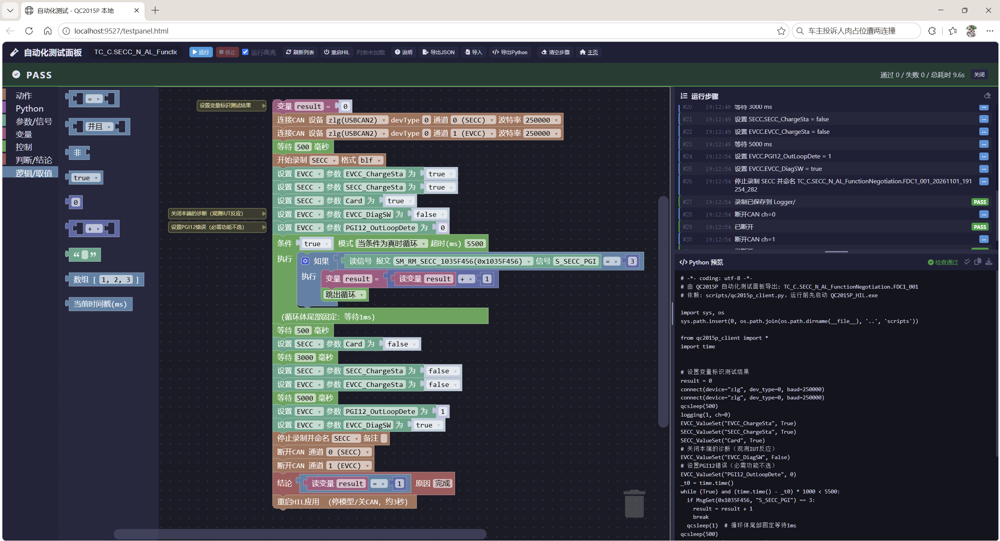
  <br/><em>▲ 自动化测试面板 — 左侧积木库 + 中间拖拽画板 + 右侧运行步骤与 Python 预览，顶部是 PASS / FAIL 结论条</em>
</p>

| 区域 | 在这里做什么 |
|:-----|:-------------|
| 🧱 **左侧积木库** | 按「动作 / Python / 参数·信号 / 变量 / 控制 / 判断·结论 / 逻辑·取值」分类，把需要的积木拖到中间 |
| 🧩 **中间画板** | 把积木按顺序拼成一条测试流程；黄色便签是**说明注释**（只给人看，不执行），积木可以**禁用**（保留在现场但不运行） |
| 📋 **右侧运行步骤** | 运行时逐步滚动：每步 PASS/FAIL 徽章、时间戳、耗时；下方同步生成 **Python 预览** |
| 🟢 **顶部结论条** | 通过 / 失败计数 + 总耗时；哪一步没过，一眼就能看到 |

**截图里的示例**是一条真实一致性用例 `TC_C.SECC_N_AL_FunctionNegotiation.FDC1_001`，从上往下读就是测试步骤：

1. **准备**：连接两路 CAN（0=充电桩，1=车辆）→ 等 500ms → 开始 BLF 录制
2. **构造条件**：设置充电桩与车辆参数（便签写着"关闭本端的诊断（观测被测设备的反应）"这类说明）
3. **等结果**：5500ms 超时循环里反复读 `S_SECC_PGI`，命中目标值就 `result + 1` 并跳出
4. **收尾**：停止录制并命名 → 断开两路 CAN → 给出结论「`result = 1`，原因：完成」
5. **可选**：脚本末尾「重启 HIL 应用」，正常收尾后重启，释放 ZLG 通道状态

跑完后右侧会列出这 30 步每一步的 PASS/FAIL 与耗时，顶部给出 **PASS** 结论。该脚本未使用 assert，所以"通过 / 失败"计数为 0；加了 assert 就会按检查项累计。

**能拖什么积木**

| 类别 | 积木 |
|:-----|:-----|
| 🔌 连接 | 连接 / 断开 CAN（虚拟或真实设备均可）、等待模型启动、重启 HIL 应用 |
| ⚙️ 参数·信号 | 设置参数、读取参数、读 DBC 信号、读 Monitor 变量、当前时间戳 |
| 🔁 控制 | 等待 N 毫秒、wait_until、if / elseif / else、for / while、break / continue |
| ✅ 判断·结论 | assert 检查、记录日志、录制控制、PASS / FAIL 结论 |
| 🧩 变量·逻辑 | 数组、变量、四则运算、比较与逻辑运算 |
| 🐍 Python | Python 代码段、Python 表达式（原样插入，可写任意代码） |

**核心能力**

- **单步可视化**：步骤面板实时滚动，画板上正在执行的积木同步高亮，跑飞了也能马上定位
- **可保存、可分发**：工作区存 JSON 当模板；一键导出 **Python 脚本**，配合 `qc2015p_client.py` 离线跑（右下角即实时生成的代码，带语法检查）
- **跑得快**：轻量单点接口 + 连接复用 + 服务端实时推送（SSE），单次交互约 1 毫秒，循环采样可稳定小于 10 毫秒
- **纯本机**：Python 代码段与重启接口仅限 `127.0.0.1` 调用

### Python 脚本（可选）

需要成百上千次重复测试（跑一致性用例、做回归）时，也可以直接写 Python——客户端库仅依赖标准库，开箱即用。

```python
import sys
sys.path.insert(0, "docs")
from qc2015p_client import *

connect(baud=250000)            # 连接 CAN（双通道）
SECC_ValueSet("ChargeSta", 1)   # 设置充电桩参数
print(EVCC_ValueGet("ChargeSta"))
print(MsgGet(0x1836F456, "PGI05_K1"))
```

| 函数 | 说明 | 示例 |
|:-----|:-----|:-----|
| `connect(baud, device)` | 连接 CAN 双通道（`device` 可选 `virtual` / `zlg` / `zlgcanfd`） | `connect(device="virtual")` |
| `disconnect()` | 断开 CAN 双通道 | `disconnect()` |
| `SECC_ValueSet / Get` | 读写 SECC 参数 | `SECC_ValueSet("ChargeSta", 1)` |
| `EVCC_ValueSet / Get` | 读写 EVCC 参数 | `EVCC_ValueGet("ChargeSta")` |
| `MsgGet(id[, what])` | 读报文 / 原始字节 / 单个信号 | `MsgGet(0x1836F456, "PGI05_K1")` |
| `wait_params / poll_params` | 等参数到期望值 / 轮询采样 | `wait_params("SECC_ChargeSta", 1)` |
| `logging / rename_log` | 录制控制 / 重命名录制文件 | `logging(1, ch=0, fmt=1)` |
| `get_trace / get_status` | 报文追踪 / 系统状态 | `get_trace("SECC")` |
| `restart_hil(timeout)` | 正常收尾后重启程序 | `restart_hil()` |

> ⚡ `*_ValueSet` / `*_ValueGet` / `MsgGet` 走程序内部的**高速通道（TCP 长连接，端口 9528）**，单次约 0.3ms；不可用时自动回退普通 HTTP，脚本无需改动。
> 📌 参数名按 **Web 参数列表里的字段名原样传入**：`ChargeSta` 就传 `"ChargeSta"`，`SECC_2015P_Enable` 就传全名。
> 📄 完整说明见 [docs/API.md](docs/API.md) | 客户端源码 [docs/qc2015p_client.py](docs/qc2015p_client.py)

---

## 🏗️ 系统架构

浏览器负责"看"和"点"，C++ 主程序负责"算"和"通"，充电逻辑由 Simulink 图形化建模后自动生成代码：

```
┌─────────────────────────────────────────────────────────────────────┐
│                       浏览器 (Chrome / Edge)                         │
│                                                                     │
│   ┌──────────┐   ┌──────────┐   ┌──────────┐   ┌──────────┐       │
│   │  主页    │   │ SECC页面  │   │ EVCC页面  │   │ 自动化测试 │      │
│   │          │   │          │   │          │   │  报文追踪  │       │
│   └────┬─────┘   └────┬─────┘   └────┬─────┘   └──────────┘       │
│        └───────────────┼──────────────┘                             │
│                        │ HTTP API (JSON)                             │
└────────────────────────┼────────────────────────────────────────────┘
                         │
┌────────────────────────┼────────────────────────────────────────────┐
│                   C++ 后端 (QC2015P_HIL.exe)                         │
│                        │                                             │
│   ┌────────────────────┴────────────────────────────────────────┐   │
│   │                  HTTP Server (端口 9527)                      │   │
│   │   参数读写 │ DBC解码 │ 报文追踪 │ 高速TCP 9528 │ 录制导出     │   │
│   └──────┬──────────────┬──────────────┬────────────────────────┘   │
│          │              │              │                             │
│   ┌──────┴──────┐ ┌─────┴──────┐ ┌────┴──────┐                     │
│   │  SECC 模型   │ │  EVCC 模型  │ │ CAN 驱动层 │                    │
│   │  CPU2 绑定   │ │  CPU4 绑定  │ │ZLG 双通道  │                    │
│   │  1ms 定步长  │ │  1ms 定步长  │ │ USBCAN2/FD │                    │
│   └──────┬──────┘ └─────┬──────┘ └────┬──────┘                     │
│          │              │              │                             │
│   Simulink Coder  Simulink Coder   CAN 总线                        │
│   生成的 C++ 代码   生成的 C++ 代码   (通道0=SECC, 通道1=EVCC)       │
└─────────────────────────────────────────────────────────────────────┘
```

一句话数据流：**硬件收上来的报文一路存下来显示、一路解码成参数值；你在界面上改的参数，下一毫秒就写进模型。**

---

## 🚀 快速开始

### 📋 前置条件

| 依赖 | 说明 | 是否必需 |
|:-----|:-----|:--------:|
| **ZLG USBCAN2** 或 **USBCANFD-200U** | CAN 收发硬件——用**虚拟 CAN** 模式时不需要，用真实硬件联调时才要 | ⭕ 可选 |
| **Windows 10/11** | 操作系统 | ✅ |
| **Chrome / Edge** | 浏览器 | ✅ |

### ▶️ 使用步骤

本仓库提供的是**编译好的可执行程序**，无需编译环境，直接运行即可。

**第 1 步：下载** — 下载本仓库的 `build` 文件夹，或从 [Releases](https://github.com/Miki-Hunter/QC2015P_Platform/releases) 下载压缩包。

**第 2 步：连接 CAN（或直接用虚拟的）** — 网页 CAN 面板默认就是「**虚拟CAN（无硬件）**」，直接点连接即可开始测试。要接真实设备时，把 USBCAN2（或 USBCANFD-200U）插上 USB、装好驱动，在面板里切换对应型号，程序会自动匹配驱动。

**第 3 步：启动程序** — 进入 `build` 文件夹，双击 `QC2015P_HIL.exe`。

> ⚠️ 请保持 `build` 目录完整（DLL、`web`、`model`、DBC 文件），程序运行时需要读取这些资源。

**第 4 步：浏览器访问**

| 页面 | 地址 | 说明 |
|:-----|:-----|:-----|
| 🏠 主页 | http://localhost:9527 | 导航入口 |
| 🔌 SECC | http://localhost:9527/secc.html | 充电桩端测试 |
| 🚗 EVCC | http://localhost:9527/evcc.html | 车辆端测试 |
| 🤖 自动化测试 | http://localhost:9527/testpanel.html | 拖拽编排测试脚本，自动给出 PASS/FAIL |

---

## 📁 文件结构

```
QC2015P_Platform/
│
├── 📂 build/                        ← 编译输出（可直接运行）
│   ├── QC2015P_HIL.exe              ← 主程序
│   ├── *.dll                        ← 运行时依赖（GCC / USBCAN / zlgcan / binlog）
│   ├── 27930_2024_MIX_update.dbc    ← DBC 定义（38 条：2024 13 + 2015 25，程序实际读取）
│   ├── 27930_2024_MIX.dbc           ← 旧版 DBC（仅 2024，保留备用）
│   ├── 📂 kerneldlls/               ← ZLG 全套设备驱动 DLL
│   ├── 📂 web/                      ← 前端页面（已构建，含自动化测试面板）
│   ├── 📂 model/                    ← Simulink 模型头文件
│   └── 📂 Logger/                   ← 录制输出与画布默认配置
│
├── 📂 docs/
│   ├── API.md                       ← HTTP API 参考
│   ├── qc2015p_client.py            ← Python 客户端库（零依赖）
│   ├── demo.py                      ← 演示脚本
│   └── screenshots/                 ← 界面截图（11 张）
│
├── 📂 通信协议一致性_GBT34658-2025/   ← 一致性测试实测报文（EVCC 版本协商）
│
├── 📄 README.md                     ← 本文件
├── 🎬 演示视频_compressed.mp4        ← 操作演示（1080p，26MB）
└── 📊 向下兼容2015协议_V1.0.blf       ← 2015 充电流程真实报文样本（CANoe 可直接打开）
```

---

## 🔧 技术栈

| 层级 | 技术 | 它负责什么（白话版） |
|:-----|:-----|:---------------------|
| **前端** | Vue.js 3 + Vite 5 | 浏览器里的界面，**不用装客户端** |
| **后端** | C++ 17 + MinGW-w64 | 真正跑仿真、收发报文的程序，**1 毫秒走一步** |
| **CAN** | ZLG USBCAN2 / USBCANFD | 和真实充电桩 / 车辆通信的硬件盒子（老款新款都支持） |
| **模型** | Simulink Coder | 充电逻辑图形化搭建，**自动生成代码** |
| **协议** | GB/T 27930.2-2024 + GB/T 27930-2015 | 新旧两版国标都支持 |
| **DBC** | CANdb++ 格式 | 报文说明书：**哪几位是电压、哪几位是电流** |
| **自动化编排** | Blockly 13 | 浏览器里**拖积木**拼测试脚本，也能导出 Python |

---

<details>
<summary><b>📚 术语小抄</b>（第一次接触充电通信？点开）</summary>

| 术语 | 一句话解释 |
|:-----|:-----------|
| **SECC** | 充电桩这一端（供电的一方） |
| **EVCC** | 车辆这一端（用电的一方） |
| **报文** | 两端之间传的一小段数据，就像对话里的一句话 |
| **CAN** | 汽车和充电设备常用的通信总线，一根线把大家连起来 |
| **DBC** | 报文的"说明书"：告诉软件哪几位代表电压、哪几位代表电流 |
| **一致性测试** | 拿国家标准逐条对照，检查设备是不是"完全合规" |
| **正向 / 反向用例** | 正常流程能不能走通 / 故意制造异常，设备能不能正确应对 |

</details>

---

## ❓ 常见问题

<details>
<summary><b>Q: 双击 exe 没反应？</b></summary>

用命令行运行查看错误信息。常见原因：缺少 DLL（确保 `build` 目录完整）、9527 端口被占用。

> 9528（高速命令端口）被占用不影响启动，程序会打印 `[WARN] Fast port 9528 bind failed` 后继续运行，Python 客户端自动回退 HTTP。
</details>

<details>
<summary><b>Q: CAN 连接失败？</b></summary>

1. 不插硬件也能测：面板里选「**虚拟CAN（无硬件）**」即可，它不占用任何设备。
2. 用真实硬件时，确保**没有其他 CAN 软件**（CANoe、USBCAN 工具等）占用同一设备，且面板选的**型号与实际一致**（老款「USBCAN2」、新款「USBCANFD-200U」）。
</details>

<details>
<summary><b>Q: 参数修改不生效？</b></summary>

1. 确保点击了「**应用**」按钮
2. 确保对应的 **Enable** 参数已设为 `true`
3. 确保模型正在运行（CAN 已连接）
</details>

<details>
<summary><b>Q: <code>2015P_Enable</code> 开关是什么意思？</b></summary>

表示**本端是否支持 2015P（2024 新协议）**：`true`（默认）支持 2024 且兼容 2015，实际走哪套由协商决定；`false` 则本端只跑 2015。只要有一方为 `false`，要么整体走 2015，要么充电失败。详见[双协议章节](#🔌-双协议2024-新国标--2015-旧快充)。
</details>

<details>
<summary><b>Q: 浏览器页面空白？</b></summary>

1. 确保 `build/web` 目录完整
2. 确保程序已启动且无报错
3. 清除浏览器缓存后刷新
</details>

---

## 📄 相关文档

- [HTTP API 参考文档](docs/API.md) — 完整接口说明（含高速 TCP、SSE、自动化面板接口）
- [Python 客户端库](docs/qc2015p_client.py) — 零依赖，直接 import
- [Python 演示脚本](docs/demo.py) — `python demo.py` 即可运行

---

<details>
<summary><b>📝 更新记录</b>（点开查看）</summary>

- **2026-11-02** — 新增**虚拟 CAN 设备**（`virtual`）：无硬件也能双端联调——充电桩与车辆两路在程序内部桥接互通，报文追踪、录制、DBC 解码与真实硬件路径完全一致；CAN 面板与自动化面板「连接CAN」积木均支持，网页端默认即虚拟设备
- **2026-11-01** — 新增自动化测试面板（Blockly 拖拽编排、单步可视化、PASS/FAIL、JSON/Python 导出）；CAN 异步 I/O 修复 USBCANFD-200U 报文周期漂移；新增轻量接口 `/api/param`、`/api/dbc/msg` 与 SSE `/api/stream`，单次交互约 1ms
- **2026-10-28** — 支持 ZLG USBCANFD-200U（`zlgcanfd` 驱动，驱动 DLL 随仓库分发）；2015 报文界面解码（38 条 DBC + BRM/BCP/BCS 的 J1939 多包重组）
- **2026-10-09** — 新增 GB/T 34658-2025 一致性测试报文目录，首批 EVCC 版本协商用例
- **2026-09-27** — 兼容 GB/T 27930-2015：旧协议阶段显示、2015 协议栈与参数体系、示例报文 `向下兼容2015协议_V1.0.blf`
- **更早** — 长消息重组、10 万条报文追踪与虚拟滚动、参数画布、1ms 定步长、双通道 CAN 等

</details>

---

<p align="center">
  <b>⚡ QC2015P 本地平台 — 让充电通信测试变得简单 ⚡</b>
  <br/><br/>
  如有问题或建议，请联系项目维护者。
</p>
