<p align="center">
  <h1 align="center">⚡ QC2015P Charging Communication Protocol Local Test Platform</h1>
  <p align="center"><b>GB/T 27930.2-2024 Standard · Backward Compatible with GB/T 27930-2015 · Dual-end EVSE & EV Simulation · One-click Launch</b></p>
  <p align="center">
    
    
    
    
    
    
  </p>
</p>

<p align="center">
  <a href="README.md">🇨🇳 中文</a> | <b>🇬🇧 English</b>
</p>

---

## 🎬 Demo Video

<p align="center">
  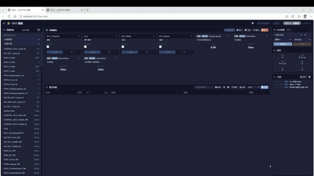
</p>

<details>
<summary>📥 Download Original HD Video (1080p MP4)</summary>

Download the original recording from the [Releases](https://github.com/Miki-Hunter/QC2015P_Platform/releases) page.

</details>

---

## 📖 What Is This?

In one sentence: **A single PC + a CAN adapter (a small USB-to-CAN box) can fully simulate the entire charging communication process between an EVSE (charger) and an EV in the lab.**

```
┌──────────────────────────────────────────────────────────┐
│                    Your PC (Windows)                      │
│                                                          │
│   ┌─────────────────────────────────────────────────┐    │
│   │            QC2015P Test Platform (exe)          │    │
│   │                                                 │    │
│   │   ┌───────────┐       ┌───────────┐            │    │
│   │   │  SECC Model│       │  EVCC Model│           │    │
│   │   │ (EVSE Side)│       │ (EV Side)  │           │    │
│   │   └─────┬─────┘       └─────┬─────┘            │    │
│   │         └──────────┬────────┘                   │    │
│   │              CAN Bus Communication              │    │
│   └────────────────────┼────────────────────────────┘    │
│                        │ USB                             │
│              ┌─────────┴─────────┐                       │
│              │   ZLG USBCAN2     │                       │
│              │   CAN Adapter      │                       │
│              └───────────────────┘                       │
└──────────────────────────────────────────────────────────┘
```

**In one line: it turns charging-communication testing from "you need a real car, a real charger and somebody staring at a screen" into "one PC, repeatable on demand, fully recorded".**

| The traditional way | With this platform |
|---------------------|--------------------|
| Assemble a real EVSE + real vehicle, then queue for a test bench | Both the charger and the vehicle are played by software on one PC |
| Reproducing an intermittent fault means booking the car and the charger again | Pull-the-plug, timeout, dropped-frame and other fault scenarios replay on demand — just change a parameter |
| Every test-condition change means recompile, reflash, restart | Edit it in the browser; effective in milliseconds, no downtime |
| After a failure, someone has to recall what was on screen | 100K communication records kept automatically, exportable anytime for review |
| Messages are raw hex and unreadable to humans | Auto-translated into named values (voltage / current / SOC), each message colour-coded |

> If all you want to know is "what's good about it" — **fewer people, less equipment, less time, and repeatable results.**

**Typical uses**: development self-test · pre-certification / acceptance testing · customer demos · field-failure reproduction

---

## 🌟 Key Highlights

<table>
<tr>
<td width="50%" valign="top">

### 🚗🔌 One PC Plays Both Ends
The charger and the vehicle run **side by side** on the same PC, each advancing in 1ms steps and talking over a CAN cable — a complete charging session, start to finish.

</td>
<td width="50%" valign="top">

### 📊 Open a Browser and You're In
No client to install: **change parameters, watch messages, follow the charging progress**, with the current phase visible at a glance.

</td>
</tr>
<tr>
<td width="50%" valign="top">

### 🔧 Changes Take Effect Instantly
Drag a parameter onto the canvas, edit the value, click "Apply" — **effective in milliseconds**. No restart, and certainly no reflashing.

</td>
<td width="50%" valign="top">

### 🤖 Automate Without Writing Code
**Drag blocks together** to build a test script, hit run, and get a PASS/FAIL verdict; anyone who writes Python can export the same script and run it offline.

</td>
</tr>
<tr>
<td width="50%" valign="top">

### 🔄 Both Protocol Generations Supported
One model ships the **2024 national standard** and the **2015 legacy fast-charging** protocol stacks — which one runs is negotiated between the two ends.

</td>
<td width="50%" valign="top">

### 📝 Recorded and Replayable End to End
Export the traffic as **ASC** (opens directly in CANoe) or **BLF**, ready for review, evidence, or analysis in your usual tools.

</td>
</tr>
</table>

---

## 🖥️ Interface Overview

### Home Page

<p align="center">
  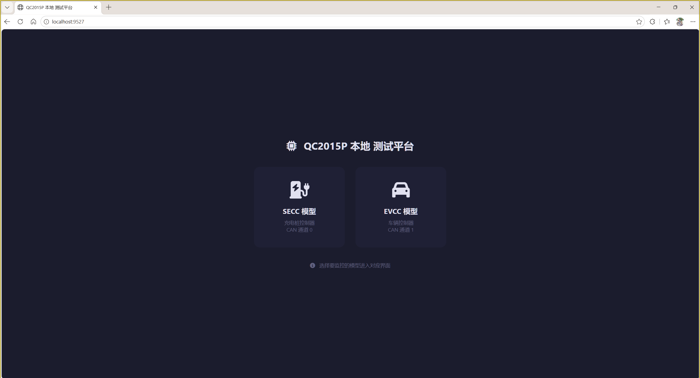
  <br/><em>▲ Home — choose SECC (EVSE side), EVCC (vehicle side) or the automation panel</em>
</p>

### SECC Page (EVSE Side) — Full View

<p align="center">
  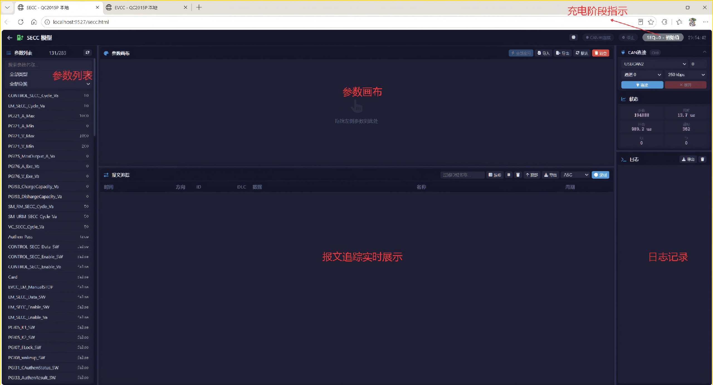
  <br/><em>▲ SECC page — charging phase indicator on top, parameter list on the left, parameter canvas in the middle, message trace at the bottom</em>
</p>

### EVCC Page (Vehicle Side) — Full View

<p align="center">
  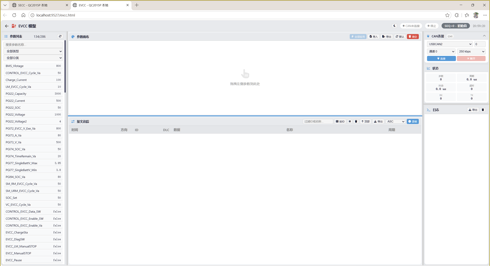
  <br/><em>▲ EVCC page — same layout as SECC, with parameters and messages for the vehicle side</em>
</p>

---

## 🔍 Feature Details

### 1️⃣ Real-time Charging Phase Indicator

The top navigation bar shows the current charging phase in real time, with colours changing automatically:

<p align="center">
  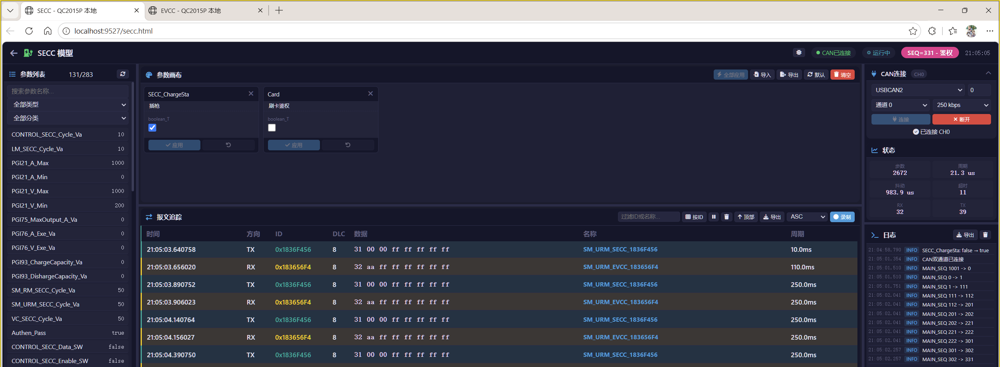
  <br/><em>▲ Top SEQ badge — current phase "Authentication", pink background</em>
</p>

| Phase | SEQ Value | Colour |
|:------|:---------:|:------:|
| Initial | 0 | 🩶 Gray |
| Version Negotiation | 1 | 🩵 Cyan |
| Function Negotiation | 2~200 | 💙 Blue |
| Parameter Configuration | 201~300 | 💜 Purple |
| **Authentication** | **301~400** | **💗 Pink** |
| Reservation | 401~500 | ❤️ Rose |
| Output Circuit Detection | 501~600 | 🧡 Orange |
| Power Supply Mode | 601~700 | 🟠 Dark Orange |
| Pre-charge | 701~750 | 💚 Green |
| Energy Transfer | 751~777 | 🟢 Bright Green |
| Charging Pause / Termination | 778~800 | 💛 / ❤️ |
| Charging Complete | 801~900 | 🩵 Teal |

> The 2015 legacy phases (SEQ 10~99, labelled `(old)`) and the reconnect/reboot branches (SEQ 1000~1020) are shown too; unknown values render as "unknown".

### 2️⃣ Parameter Canvas — Drag & Drop

Drag parameters from the left list onto the canvas to **view and modify** values in real time:

<p align="center">
  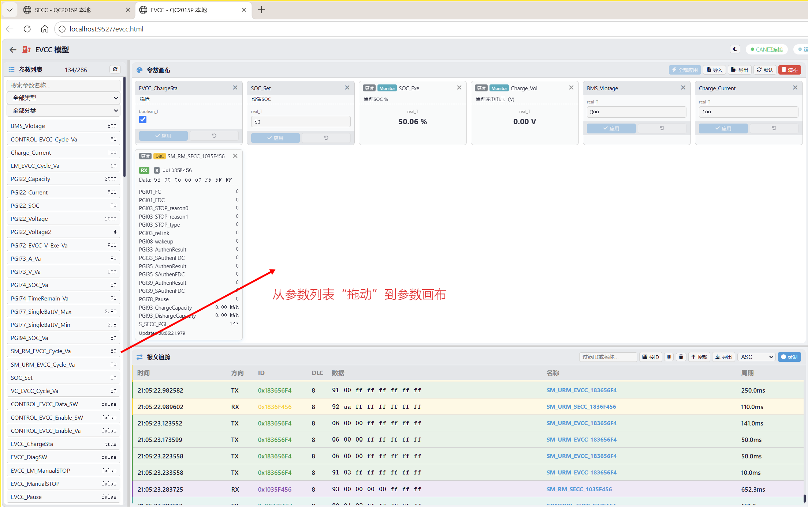
  <br/><em>▲ Parameter canvas — drag cards onto the canvas, edit values in real time, gray text shows notes</em>
</p>

| Type | Editable | Description |
|:-----|:--------:|:------------|
| 🔧 Model Parameters | ✅ Read/Write | **The test conditions you want to change** (voltage, current, enable switches…); effective immediately |
| 📡 DBC Signals | 👁️ Read-only | Signal values carried in messages (voltage, current, …), **translated into names and numbers** |
| 📊 Monitor Variables | 👁️ Read-only | Live internal state (charging progress, detection results, …) |

- 🖱️ **Drag to add** · ✏️ **Click to edit** · 📋 **Apply all** · 💾 **Import/Export** (JSON) · 📌 **Default config** (common parameters on startup)

### 3️⃣ Message Trace — 15-Colour Identification

The charger and the vehicle exchange hundreds of messages per second (the trade term is "frames"). This panel lists them live, **assigning each message its own colour** so you can tell at a glance who is talking:

<p align="center">
  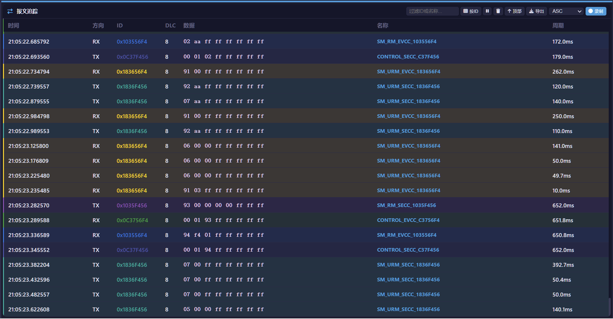
  <br/><em>▲ Message trace — 15 colours assigned by ID, with colour bar + ID text + subtle background</em>
</p>

- 📦 **100K-message buffer** — backend and frontend each keep 100K; virtual scrolling stays smooth
- 🔍 **Live filtering** — by ID or name
- ⬆️ **Scroll-up history** — earlier messages load automatically at the top
- 🖱️ **Click to decode** — open any message row for DBC signal details
- ⏱️ **Message period** — computed automatically for each ID

### 4️⃣ Recording & Export

<p align="center">
  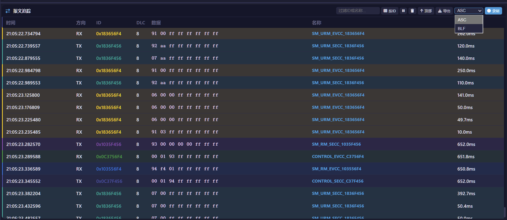
  <br/><em>▲ Recording control — pick ASC or BLF, start/stop with one click</em>
</p>

| Format | Description | Tool |
|:-------|:------------|:-----|
| **ASC** | Text format, human-readable | Open directly in CANoe / CANalyzer |
| **BLF** | Vector binary format, smaller files | CANoe / CANalyzer / Python |

- SECC and EVCC record **independently**; files are named automatically (e.g. `SECC_20260830_143022.asc`)

### 5️⃣ Parameter List — Three in One

<p align="center">
  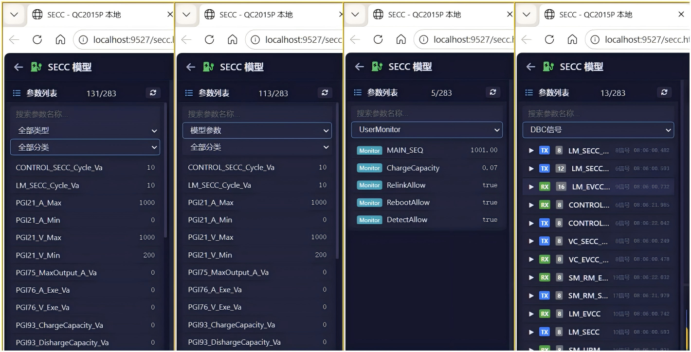
  <br/><em>▲ Parameter list — model parameters, DBC signals and Monitor variables in one place</em>
</p>

- 🔧 **Model parameters** — filter by category, search, editable
- 📡 **DBC signals** — grouped by message, with TX/RX direction and sender
- 📊 **Monitor variables** — live refresh, read-only

### 6️⃣ Dark / Light Theme

<p align="center">
  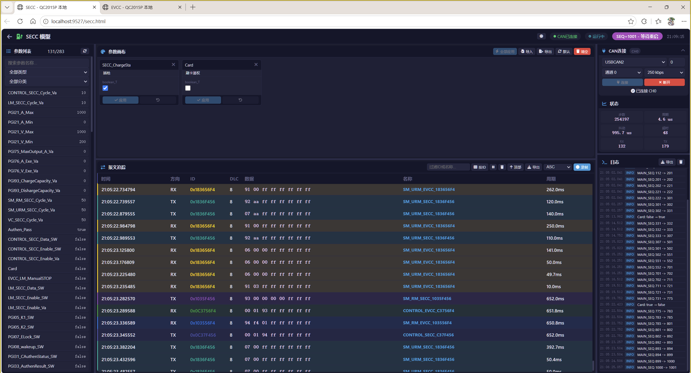
  &nbsp;&nbsp;
  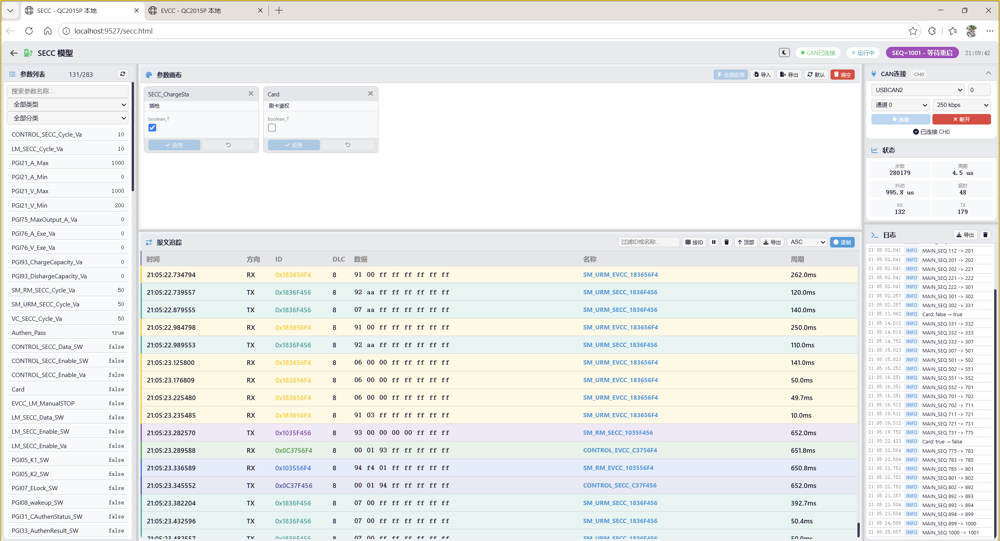
  <br/><em>▲ Left: dark theme (tech style, for demos) | Right: light theme (clean, for daily use)</em>
</p>

---

## 🔌 Dual Protocol: 2024 Standard + 2015 Legacy

One model ships both protocol stacks, and **which flow actually runs is decided by negotiation between the two ends** — "new charger + old vehicle" and "old charger + new vehicle" need neither different hardware nor a different build.

| Side | Switch | Default | Meaning |
|:-----|:-------|:-------:|:--------|
| EVSE side (SECC) | `SECC_2015P_Enable` | `true` | Whether **this end supports 2015P** (i.e. the 2024 standard) |
| EV side (EVCC) | `EVCC_2015P_Enable` | `true` | same |

- **`true` (default)**: supports 2024 and remains 2015-compatible. Negotiation decides — even with both ends enabled it may fall back to 2015 when the **version is below 2.0.0**; if either end is `false`, the session runs 2015 or fails to charge.
- **`false`**: this end runs 2015 only (2015P is backward compatible with 2015, so charging still works).

**Supported 2015 messages**

| Side | Message set |
|:-----|:------------|
| 🔌 SECC | `CHM` handshake · `CRM` recognition · `CRO` ready · `CML` params · `CCS` charging · `CST` stop · `CSD` statistics · `CEM` error |
| 🚗 EVCC | `BHM` handshake · `BRM` recognition · `BCP` params · `BRO` ready · `BCL` demand · `BCS` status · `BSM` monitoring · `BST` stop · `BSD` statistics · `BEM` error |

> Transport-layer messages are grouped under the `TP_*` prefix.

**How deep the control goes** (full parameter reference in [docs/API.md](docs/API.md)):

- **Message level**: decide per message whether it is sent, how often, and whether its payload uses custom values
- **Signal level**: rewrite one specific field inside a message (battery type, SOC, …)
- **Raw injection**: inject an extra message of your own to simulate a faulty device
- **How parameters are named**: pairs of `_SW` (switch, default off) + `_Va` (the value used once the switch is on) — leave everything untouched and the model drives it; full names in [docs/API.md](docs/API.md)

**2015 messages are decoded in the UI too**: the built-in dictionary has 38 messages (13 from 2024 + 25 from 2015); multi-packet `BRM`/`BCP`/`BCS` are reassembled via J1939 before decoding, so the trace shows names and signal values directly.

📊 A real sample recording ships in the repository root: [`向下兼容2015协议_V1.0.blf`](向下兼容2015协议_V1.0.blf) — open it in CANoe / CANalyzer, no hardware required.

---

## 🧪 Protocol Conformance Testing (GB/T 34658-2025)

**What it buys you**: now that the new national standard is in force, "it charges" is no longer enough — certification bodies and OEM acceptance teams ask whether **every item the standard requires** is satisfied. This folder holds **recorded traffic from conformance runs** on this platform, ready to keep as evidence, hand over, or review.

**GB/T 34658-2025 — "Conformance test of the communication protocol between off-board conductive chargers and the battery management system of electric vehicles"** is the **companion test standard** to the GB/T 27930 series: it defines *how to verify each item one by one*.

| Layer | What it checks | Typical items |
|:------|:---------------|:--------------|
| **Physical (PL)** | Electrical characteristics | CAN terminating resistor (120 Ω ±10%), bit rate (250 kbit/s) |
| **Data link (DL)** | Single-frame compliance | Data frame format, **version negotiation** |
| **Transport (TL)** | Multi-frame long messages | Long-message send / receive (LM / RM / URM) |
| **Application (AL)** | End-to-end charging logic | Wake-up, function negotiation, parameter configuration, authentication, charging schedule, power supply mode, pre-charging & energy transfer, phase ack, suspend, end of charging, backward compatibility… |

The standard contains roughly **370 cases**, split evenly between charger and vehicle, each in a **positive** (normal flow) and a **negative** (fault injection) variant:

| Device under test | Positive | Negative | Total |
|:------------------|:--------:|:--------:|:-----:|
| 🔌 SECC (charger) | 71 | 114 | **185** |
| 🚗 EVCC (vehicle) | 67 | 117 | **184** |

### Recordings included

📂 [`通信协议一致性_GBT34658-2025/`](通信协议一致性_GBT34658-2025/) — **53 BLF files** so far:

| Device under test | Covered items |
|:------------------|:--------------|
| 🚗 EVCC (vehicle) | Version negotiation (DL), long messages LM.X (TL), function negotiation / parameter configuration / phase ack (AL) |
| 🔌 SECC (charger) | Function negotiation / parameter configuration (AL) |

All captured automatically by this platform and openable frame by frame in CANoe / CANalyzer.

How to read a test-case ID:

```
TC_C . EVCC _ P _ DL _ VersionNegotiation _ 001
  │      │    │   │          │              └─ index within the item
  │      │    │   │          └──────────────── test item
  │      │    │   └─────────────────────────── layer: PL / DL / TL / AL
  │      │    └─────────────────────────────── type: P positive / N negative
  │      └──────────────────────────────────── device under test: EVCC / SECC
  └─────────────────────────────────────────── test case
```

> 🚧 **Work in progress**: EVCC version negotiation, long messages and some application-layer cases are covered, plus some SECC application-layer cases; the rest follow in standard order.

---

## 🤖 Automation

### Drag-and-Drop Test Panel (no coding)

**What it buys you**: regression testing no longer means an engineer clicking through the UI, and nobody has to learn Python — drag "connect CAN → wait for model → set parameter → read signal → check → record verdict" together like blocks, press run, and the platform executes it end to end with a **PASS / FAIL** verdict.

**Entry point**: the "Automation" card on the home page, or go straight to http://localhost:9527/testpanel.html

<p align="center">
  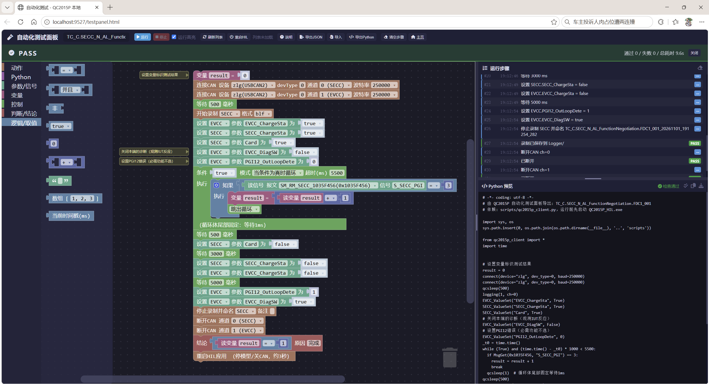
  <br/><em>▲ Automation test panel — block library on the left, drag-and-drop canvas in the middle, run steps and Python preview on the right, PASS / FAIL verdict bar on top</em>
</p>

| Pane | What you do there |
|:-----|:------------------|
| 🧱 **Block library (left)** | Categories: Action / Python / Parameter·Signal / Variable / Control / Verdict / Logic — drag what you need onto the canvas |
| 🧩 **Canvas (middle)** | Assemble the blocks into a test flow; yellow notes are **comments** (for humans, not executed), and blocks can be **disabled** (kept but skipped) |
| 📋 **Run steps (right)** | Scrolls in real time with a PASS/FAIL badge, timestamp and duration per step; the **Python preview** is generated underneath |
| 🟢 **Verdict bar (top)** | Pass/fail counts and total duration — a failing step is visible immediately |

**The example in the screenshot** is a real conformance case, `TC_C.SECC_N_AL_FunctionNegotiation.FDC1_001`; read top to bottom it *is* the test procedure:

1. **Set up**: connect both CAN channels (0 = charger, 1 = vehicle) → wait 500ms → start BLF recording
2. **Build the condition**: set charger and vehicle parameters (notes such as "disable this side's diagnostics (observe the device under test)")
3. **Wait for the result**: inside a 5500ms timeout loop, read `S_SECC_PGI` repeatedly; on the target value, `result + 1` and break out
4. **Wrap up**: stop and name the recording → disconnect both channels → verdict "`result = 1`, reason: complete"
5. **Optional**: end with "restart HIL app" to shut down cleanly and release the ZLG channel state

Afterwards the right-hand panel lists PASS/FAIL and duration for all 30 steps and the top bar shows **PASS**. This script uses no `assert` checks, hence the 0 / 0 counters; add asserts and they accumulate per check.

**Available blocks**

| Category | Blocks |
|:---------|:-------|
| 🔌 Connection | Connect / disconnect CAN, wait for model, restart HIL app |
| ⚙️ Parameter·Signal | Set parameter, get parameter, read DBC signal, read Monitor variable, current timestamp |
| 🔁 Control | Wait N ms, wait_until, if / elseif / else, for / while, break / continue |
| ✅ Verdict | assert check, log, recording control, PASS / FAIL |
| 🧩 Variable·Logic | Arrays, variables, arithmetic, comparison and logic |
| 🐍 Python | Python code snippet, Python expression (inserted verbatim — any code goes) |

**Key capabilities**

- **Step-by-step visualization**: the step panel scrolls live and the executing block is highlighted — when something goes wrong you see exactly where
- **Save and share**: the workspace saves to JSON as a template; export to a **Python script** that runs offline with `qc2015p_client.py` (bottom-right of the screenshot, syntax-checked)
- **Fast**: lightweight single-item endpoints + connection reuse + server-side push (SSE) — about 1ms per interaction, loop sampling under 10ms
- **Local only**: Python snippets and the restart endpoint are restricted to `127.0.0.1`

### Python Scripts (Optional)

For hundreds or thousands of repeated runs (conformance cases, regressions), you can also write Python directly — the client library uses only the standard library.

```python
import sys
sys.path.insert(0, "docs")
from qc2015p_client import *

connect(baud=250000)            # connect CAN (both channels)
SECC_ValueSet("ChargeSta", 1)   # set an EVSE parameter
print(EVCC_ValueGet("ChargeSta"))
print(MsgGet(0x1836F456, "PGI05_K1"))
```

| Function | Description | Example |
|:---------|:------------|:--------|
| `connect(baud, device)` | Connect both CAN channels (`device` = `zlg` / `zlgcanfd`) | `connect(device="zlgcanfd")` |
| `disconnect()` | Disconnect both channels | `disconnect()` |
| `SECC_ValueSet / Get` | Read/write SECC parameters | `SECC_ValueSet("ChargeSta", 1)` |
| `EVCC_ValueSet / Get` | Read/write EVCC parameters | `EVCC_ValueGet("ChargeSta")` |
| `MsgGet(id[, what])` | Read a message / raw bytes / one signal | `MsgGet(0x1836F456, "PGI05_K1")` |
| `wait_params / poll_params` | Wait for a value / sample repeatedly | `wait_params("SECC_ChargeSta", 1)` |
| `logging / rename_log` | Recording control / rename a recording | `logging(1, ch=0, fmt=1)` |
| `get_trace / get_status` | Message trace / system status | `get_trace("SECC")` |
| `restart_hil(timeout)` | Restart the program cleanly | `restart_hil()` |

> ⚡ `*_ValueSet` / `*_ValueGet` / `MsgGet` use the program's **internal high-speed channel (persistent TCP, port 9528)** at ≈0.3ms each, and fall back to plain HTTP automatically — no script changes needed.
> 📌 Parameter names are the **field names exactly as shown in the Web UI**: pass `"ChargeSta"` for `ChargeSta`, and the full name for `SECC_2015P_Enable`.
> 📄 Full reference: [docs/API.md](docs/API.md) | Client source: [docs/qc2015p_client.py](docs/qc2015p_client.py)

---

## 🏗️ System Architecture

The browser handles "seeing" and "clicking", the C++ program does the "computing" and "communicating", and the charging logic is built graphically in Simulink and turned into code automatically:

```
┌─────────────────────────────────────────────────────────────────────┐
│                       Browser (Chrome / Edge)                        │
│                                                                     │
│   ┌──────────┐   ┌──────────┐   ┌──────────┐   ┌──────────┐       │
│   │   Home   │   │ SECC Page│   │ EVCC Page│   │ Automation│       │
│   │          │   │          │   │          │   │  Trace    │       │
│   └────┬─────┘   └────┬─────┘   └────┬─────┘   └──────────┘       │
│        └───────────────┼──────────────┘                             │
│                        │ HTTP API (JSON)                             │
└────────────────────────┼────────────────────────────────────────────┘
                         │
┌────────────────────────┼────────────────────────────────────────────┐
│                   C++ Backend (QC2015P_HIL.exe)                      │
│                        │                                             │
│   ┌────────────────────┴────────────────────────────────────────┐   │
│   │                  HTTP Server (Port 9527)                     │   │
│   │  Param R/W │ DBC Decode │ Trace │ Fast TCP 9528 │ Recording │   │
│   └──────┬──────────────┬──────────────┬────────────────────────┘   │
│          │              │              │                             │
│   ┌──────┴──────┐ ┌─────┴──────┐ ┌────┴──────┐                     │
│   │  SECC Model  │ │  EVCC Model │ │ CAN Driver│                    │
│   │  CPU2 Bound  │ │  CPU4 Bound  │ │ZLG Dual Ch│                    │
│   │  1ms Step    │ │  1ms Step    │ │USBCAN2/FD │                    │
│   └──────┬──────┘ └─────┬──────┘ └────┬──────┘                     │
│          │              │              │                             │
│   Simulink Coder  Simulink Coder   CAN Bus                         │
│   Generated C++   Generated C++   (Ch0=SECC, Ch1=EVCC)             │
└─────────────────────────────────────────────────────────────────────┘
```

Data flow in one line: **frames from the hardware are stored for display and decoded into parameter values; a parameter you edit lands in the model on the next millisecond.**

---

## 🚀 Quick Start

### 📋 Prerequisites

| Dependency | Description | Required |
|:-----------|:------------|:--------:|
| **ZLG USBCAN2** or **USBCANFD-200U** | CAN adapter hardware (either one) | ✅ |
| **Windows 10/11** | Operating system | ✅ |
| **Chrome / Edge** | Browser | ✅ |

### ▶️ Usage Steps

This repository provides **pre-compiled executables** — no build environment needed.

**Step 1: Download** — grab the `build` folder, or the packaged archive from [Releases](https://github.com/Miki-Hunter/QC2015P_Platform/releases).

**Step 2: Connect CAN Hardware** — plug in a USBCAN2 (or USBCANFD-200U) via USB and install the driver. Pick the matching model in the web CAN panel; the program selects the driver automatically.

**Step 3: Launch** — enter the `build` folder and double-click `QC2015P_HIL.exe`.

> ⚠️ Keep the `build` directory intact (DLLs, `web`, `model`, DBC files) — the program reads them at runtime.

**Step 4: Access in Browser**

| Page | URL | Description |
|:-----|:----|:------------|
| 🏠 Home | http://localhost:9527 | Navigation entry |
| 🔌 SECC | http://localhost:9527/secc.html | EVSE side testing |
| 🚗 EVCC | http://localhost:9527/evcc.html | Vehicle side testing |
| 🤖 Automation | http://localhost:9527/testpanel.html | Drag-and-drop test scripting with PASS/FAIL |

---

## 📁 File Structure

```
QC2015P_Platform/
│
├── 📂 build/                        ← Compiled output (run directly)
│   ├── QC2015P_HIL.exe              ← Main program
│   ├── *.dll                        ← Runtime deps (GCC / USBCAN / zlgcan / binlog)
│   ├── 27930_2024_MIX_update.dbc    ← DBC (38 messages: 13 x 2024 + 25 x 2015, the one loaded)
│   ├── 27930_2024_MIX.dbc           ← Older DBC (2024 only, kept as backup)
│   ├── 📂 kerneldlls/               ← Full ZLG device driver DLL set
│   ├── 📂 web/                      ← Frontend pages (built, incl. automation panel)
│   ├── 📂 model/                    ← Simulink model headers
│   └── 📂 Logger/                   ← Recording output and canvas defaults
│
├── 📂 docs/
│   ├── API.md                       ← HTTP API reference
│   ├── qc2015p_client.py            ← Python client library (zero deps)
│   ├── demo.py                      ← Demo script
│   └── screenshots/                 ← UI screenshots (11 images)
│
├── 📂 通信协议一致性_GBT34658-2025/   ← Conformance test recordings (EVCC version negotiation)
│
├── 📄 README.md                     ← Chinese README
├── 🎬 演示视频_compressed.mp4        ← Demo video (1080p, 26MB)
└── 📊 向下兼容2015协议_V1.0.blf       ← Sample 2015 charging session (opens in CANoe)
```

---

## 🔧 Tech Stack

| Layer | Technology | What it does (in plain words) |
|:------|:-----------|:------------------------------|
| **Frontend** | Vue.js 3 + Vite 5 | The UI in the browser — **no client install** |
| **Backend** | C++ 17 + MinGW-w64 | The program that simulates and sends/receives frames, **one step per millisecond** |
| **CAN** | ZLG USBCAN2 / USBCANFD | The hardware box talking to real chargers / vehicles (old and new sticks) |
| **Model** | Simulink Coder | Charging logic built graphically, **code generated automatically** |
| **Protocol** | GB/T 27930.2-2024 + GB/T 27930-2015 | Both generations of the national standard |
| **DBC** | CANdb++ format | The message spec: **which bits are voltage, which are current** |
| **Automation** | Blockly 13 | **Drag blocks** in the browser; export to Python |

---

<details>
<summary><b>📚 Glossary</b> (new to charging communication? open this)</summary>

| Term | In one sentence |
|:-----|:----------------|
| **SECC** | The charger side (the one supplying power) |
| **EVCC** | The vehicle side (the one drawing power) |
| **Message / frame** | A short piece of data exchanged between the two ends — one sentence in a conversation |
| **CAN** | The serial bus commonly used by vehicles and charging equipment; one cable connects everyone |
| **DBC** | The message "spec sheet": which bits mean voltage, which mean current |
| **Conformance test** | Checking a device item by item against the national standard for full compliance |
| **Positive / negative case** | The normal flow works / a fault is injected deliberately and the device must react correctly |

</details>

---

## ❓ FAQ

<details>
<summary><b>Q: Double-clicking the exe does nothing?</b></summary>

Run it from a command line to see the error. Common causes: missing DLLs (keep the `build` directory intact) or port 9527 already in use.

> Port 9528 (high-speed command port) being occupied does not prevent startup — the program prints `[WARN] Fast port 9528 bind failed` and keeps running; the Python client falls back to HTTP.
</details>

<details>
<summary><b>Q: CAN connection failed?</b></summary>

1. Ensure **no other CAN software** (CANoe, USBCAN tools, …) has the same device open.
2. Check that the **model selected in the CAN panel matches the stick**: "USBCAN2" for the older one, "USBCANFD-200U" for the newer one.
</details>

<details>
<summary><b>Q: Parameter changes not taking effect?</b></summary>

1. Make sure you clicked "**Apply**"
2. Make sure the corresponding **Enable** parameter is `true`
3. Make sure the model is running (CAN connected)
</details>

<details>
<summary><b>Q: What does the <code>2015P_Enable</code> switch mean?</b></summary>

It states **whether this end supports 2015P (the 2024 standard)**: `true` (default) supports 2024 while remaining 2015-compatible, and negotiation decides which flow runs; `false` makes this end run 2015 only. If either end is `false`, the session runs 2015 or fails to charge. See [Dual Protocol](#🔌-dual-protocol-2024-standard--2015-legacy).
</details>

<details>
<summary><b>Q: Browser page is blank?</b></summary>

1. Ensure the `build/web` directory is complete
2. Ensure the program started without errors
3. Clear the browser cache and refresh
</details>

---

## 📄 Related Documentation

- [HTTP API Reference](docs/API.md) — complete interface docs (fast TCP, SSE, automation-panel endpoints)
- [Python Client Library](docs/qc2015p_client.py) — zero dependencies, import and use
- [Python Demo Script](docs/demo.py) — run with `python demo.py`

---

<details>
<summary><b>📝 Changelog</b> (click to expand)</summary>

- **2026-11-01** — Automation test panel (Blockly drag-and-drop, step visualization, PASS/FAIL, JSON/Python export); CAN asynchronous I/O fixing USBCANFD-200U message-period drift; lightweight `/api/param`, `/api/dbc/msg` and SSE `/api/stream` (about 1ms per interaction)
- **2026-10-28** — ZLG USBCANFD-200U support (`zlgcanfd` driver, driver DLLs shipped with the repo); 2015 message decoding in the UI (38-message DBC + J1939 multi-packet reassembly for BRM/BCP/BCS)
- **2026-10-09** — GB/T 34658-2025 conformance test recordings added (first batch: EVCC version negotiation)
- **2026-09-27** — GB/T 27930-2015 compatibility: legacy phase display, 2015 protocol stack and parameter set, sample recording `向下兼容2015协议_V1.0.blf`
- **Earlier** — long-message reassembly, 100K-message trace with virtual scrolling, parameter canvas, 1ms fixed step, dual-channel CAN, etc.

</details>

---

<p align="center">
  <b>⚡ QC2015P Local Platform — Making Charging Communication Testing Simple ⚡</b>
  <br/><br/>
  For questions or suggestions, please contact the project maintainer.
</p>
